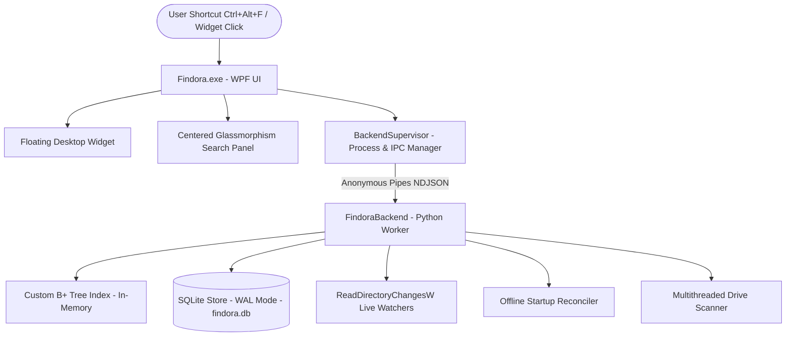

# Findora Architecture Documentation

## System Architecture

Findora is designed for instant whole-computer filename retrieval on Windows with zero user effort and native Windows 11 aesthetics.

## Key Components

1. **Findora.exe (C# .NET 8 WPF Frontend)**
   - Windows 11 glassmorphic styling, rounded corners, drop shadows, and fluent animations.
   - Dual-state widget: idle floating circular disc and centered search window.
   - Global hotkey listener (`Ctrl+Alt+F`) via Win32 `RegisterHotKey`.
   - Dynamic shell file icons via `SHGetFileInfoW` with caching and proper handle destruction.
   - Single-instance mutex enforcement with existing window foreground activation.

2. **BackendSupervisor**
   - Launches and manages the backend lifecycle.
   - Supports both bundled standalone executable (`backend/FindoraBackend.exe`) and local Python development fallback.
   - Multiplexes NDJSON requests and correlates async responses using thread-safe task completion dictionaries.
   - Real-time backend error logging to `%LOCALAPPDATA%\Findora\logs\backend.log`.
   - Auto-recovers from backend crashes and terminates cleanly on application exit.

3. **In-Memory B+ Tree Search Engine**
   - High-fanout B+ Tree (order 32) indexing filename keys to multi-path value arrays.
   - In-memory hydration allows searching across hundreds of thousands of files in under 1 millisecond.

4. **Persistent SQLite Store (`findora.db`)**
   - WAL (Write-Ahead Logging) mode with 32 MB cache.
   - Stores file records, size, modification timestamps, volume metadata, and exclusions.
   - Automatic migration: if upgrading from FastRetrival, seamlessly copies legacy data without data loss or re-scanning.

5. **Filesystem Watchers & Reconciler**
   - Real-time directory change monitoring via `ReadDirectoryChangesW`.
   - Serialized mutation queue to prevent lock contention.
   - Offline startup reconciler catches changes that occurred while the app was closed.
